<p align="center">
  
</p>

<h1 align="center">MusselApp</h1>

<p align="center">
  App móvil para el registro y trazabilidad de muestras de choritos en centros de cultivo.<br>
  Caso académico <strong>AquaSample · ALDEMAR SpA</strong> · DSY1105 Desarrollo de Aplicaciones Móviles · Duoc UC Sede Puerto Montt
</p>

---

## 1. Descripción

En el muestreo de líneas de cultivo de choritos, el operario extrae un tramo representativo de la cuerda, cuenta los individuos, toma fotografías y registra observaciones. Hoy ese flujo es manual y la información queda dispersa entre planillas, fotos y notas, lo que dificulta el seguimiento histórico de una misma línea y la revisión del supervisor.

**MusselApp** es un MVP Android que digitaliza ese proceso en terreno:

- El **operario** registra la muestra (centro, tren, línea y estrato), adjunta una fotografía, ingresa conteo y talla, y la guarda en el teléfono aunque no haya señal.
- El **supervisor** revisa las muestras pendientes y las deja **Validadas** o **Corregidas** con un comentario técnico.
- Todo queda en un **historial** consultable, con búsqueda, filtros y detalle de cada muestra.
- Cuando hay señal, cada muestra se **sube a la nube** (Firestore) y el supervisor la puede dictaminar desde el **portal web**; el dictamen vuelve al teléfono con un aviso.

> Proyecto académico con datos ficticios. No reemplaza el criterio técnico de ALDEMAR ni realiza conteo automático.

## 2. Funcionalidades implementadas

| Funcionalidad | Dónde se ve | Implementación |
|---|---|---|
| Inicio de sesión por rol (operario / supervisor), sin elegir perfil: la app lo toma del usuario | Login | `LoginViewModel` + `RoomAuthRepository`; RUT con dígito verificador (módulo 11) y formato en vivo |
| Animación de inicio y de bienvenida con el nombre del usuario y su centro | Inicio, Login | `SplashScreen` y `AnimacionBienvenida` (Compose `Canvas`, sin librerías); tocar la pantalla las salta |
| Formulario de muestra con campos obligatorios y mensajes de error | Nueva muestra | `MuestraViewModel.guardar()` valida centro, tren, línea y estrato |
| Fotografía de evidencia con cámara o galería | Captura | CameraX con permiso `CAMERA` en tiempo de ejecución; galería con Photo Picker (`PickVisualMedia`) |
| Conteo, talla y observación con validación de rangos | Vista previa | `validarBorrador()` en `BorradorMuestra.kt`; confirmación antes de guardar |
| Persistencia local que se conserva al cerrar la app | Todas | Room (SQLite): 6 entidades, 3 DAO, migraciones versionadas |
| Historial con búsqueda, filtros por estado y período, y orden | Historial | `HistorialViewModel` (`combine` + `stateIn`) y `FiltrosHistorial` |
| Detalle de la muestra con dictamen del supervisor | Detalle | `DetalleViewModel` lee la muestra por id desde Room |
| Ficha técnica en PDF: guardar, imprimir o compartir | Detalle | `FichaPdf` con `PrintManager` y `FileProvider` |
| Revisión del supervisor: validar o corregir (al corregir, comentario de al menos 5 caracteres, igual que en el portal) | Supervisión | `RevisionViewModel` registra la revisión y cambia el estado |
| Posición GPS de la muestra y distancia al centro de cultivo | Vista previa, Detalle | `UbicadorGps` (servicios de ubicación de Google) con permiso en tiempo de ejecución; sin permiso o sin señal la muestra se guarda igual |
| Clima y estado del mar al muestrear (viento, racha, ola, temperatura del agua, marea) | Detalle, ficha PDF | API REST de [Open-Meteo](https://open-meteo.com) con Retrofit (`ClimaRepository`); guardar nunca espera a la red |
| Alertas automáticas para el supervisor (fuera del área, densidad, cholgas, talla, mal tiempo) | Supervisión, Detalle, portal web | `AlertasMuestra.evaluar()`, reglas puras con los límites en `Umbrales` |
| Métricas de la jornada y muestras recientes | Principal | `PrincipalViewModel` + `ResumenJornada` |
| Sincronización con la nube y dictamen desde el computador | Todas, portal web | `NubeSync` (Firestore) detrás de la interfaz `ServicioNube`; Room sigue siendo la fuente de verdad, se guarda sin red y se sube después. El supervisor puede dictaminar en el portal o en el teléfono: el dictamen del teléfono se sube de inmediato y, si los dos dictaminan la misma muestra, vale el primero que llegó a la nube (`ProteccionDictamen`) |
| Envío automático de lo pendiente, aunque la app esté cerrada | Todas | WorkManager (`EnvioPendientesWorker`): cada muestra pendiente nueva deja un envío en cola que corre apenas hay internet, con reintentos (espera exponencial, hasta 8 intentos). Con la app abierta, además, se reenvía al volver la conexión (`Conectividad`) |
| Muestra borrada en el portal | Notificación, Historial | Al eliminar una muestra en el portal, el teléfono que la registró la borra (con sus revisiones y su foto) y avisa con una notificación |
| Conteo asistido con marcas sobre la foto | Vista previa | `ConteoSobreFoto`: se toca cada individuo para marcarlo (o quitarlo), con zoom, Deshacer y Limpiar; el total se convierte a ind/m con el tramo muestreado y completa el campo Conteo (`ConteoMarcas.indPorMetro`) |
| Seguridad local | Login | PIN guardado con hash PBKDF2, bloqueo tras 5 intentos fallidos y base excluida del respaldo |

**Recursos del dispositivo integrados al flujo:** cámara, galería (Photo Picker), ubicación (GPS), documentos (ficha PDF para imprimir o compartir) y fecha/hora del registro.

**Servicio externo:** el clima y el estado del mar vienen de Open-Meteo (gratis, sin clave). Son datos modelados: en canales interiores el oleaje es una referencia, no una medición. Los límites de las alertas son supuestos del caso académico, no normas del rubro.

## 3. Capturas

Capturas de la versión 1.3.0 en un teléfono Android, con los datos de ejemplo de la app (usuarios, muestras y foto ficticios).

**Inicio y operario**

| Inicio | Login | Principal | Muestras recientes desplegadas |
|---|---|---|---|
| 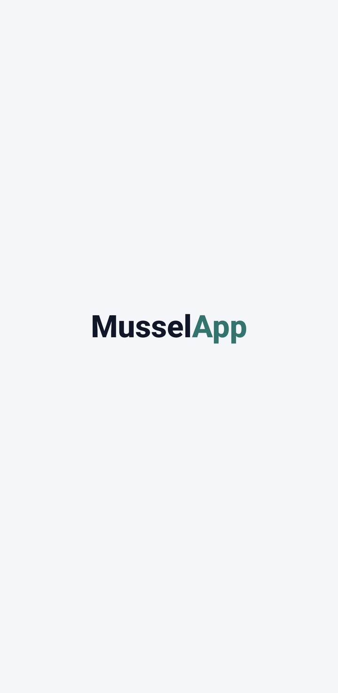 |  | 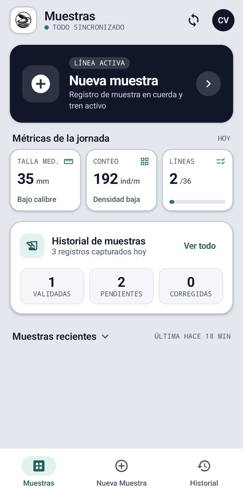 | 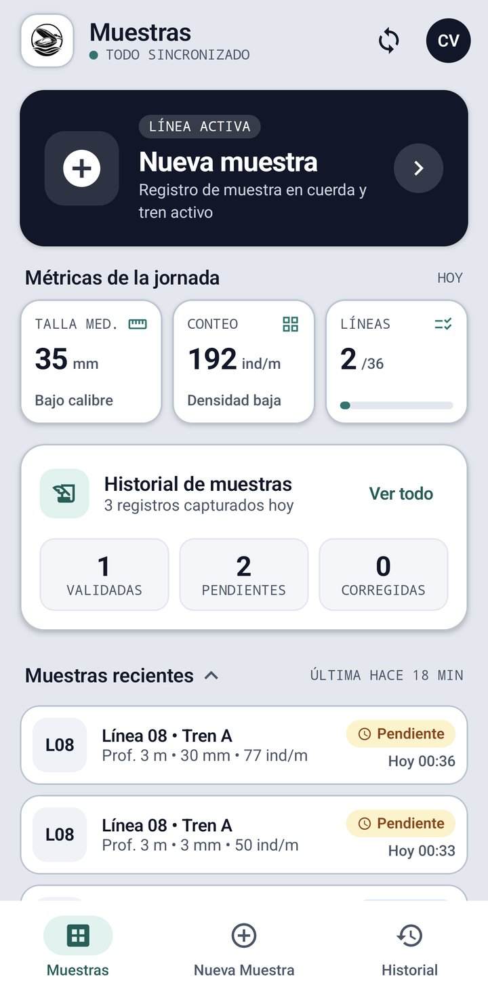 |

**Nueva muestra: parámetros y foto**

| Parámetros | Validación de campos | Parámetros completos | Captura |
|---|---|---|---|
| 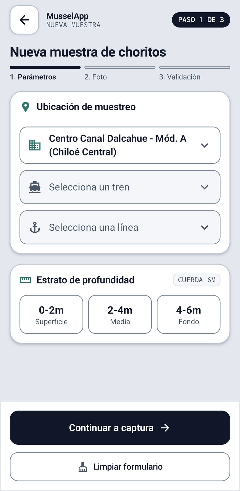 | 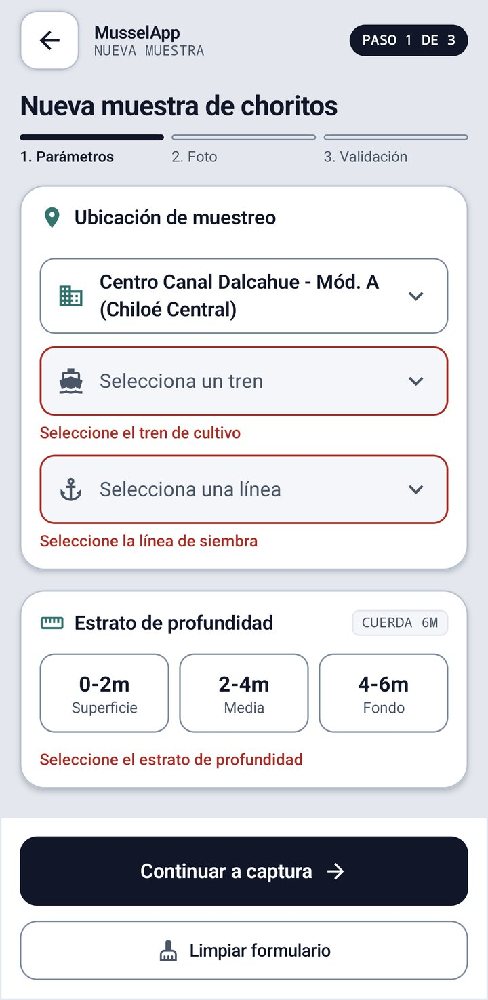 | 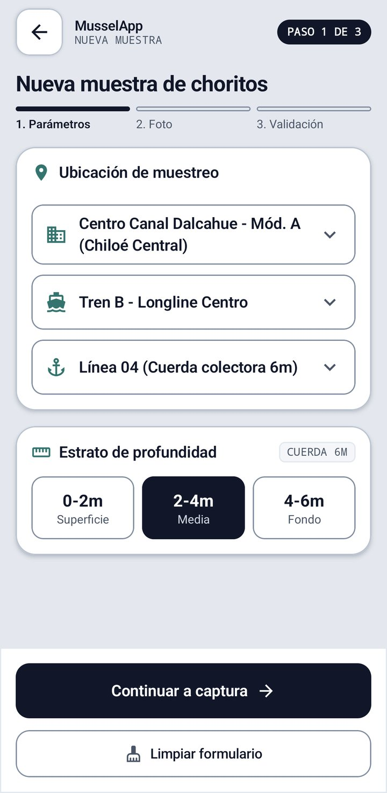 | 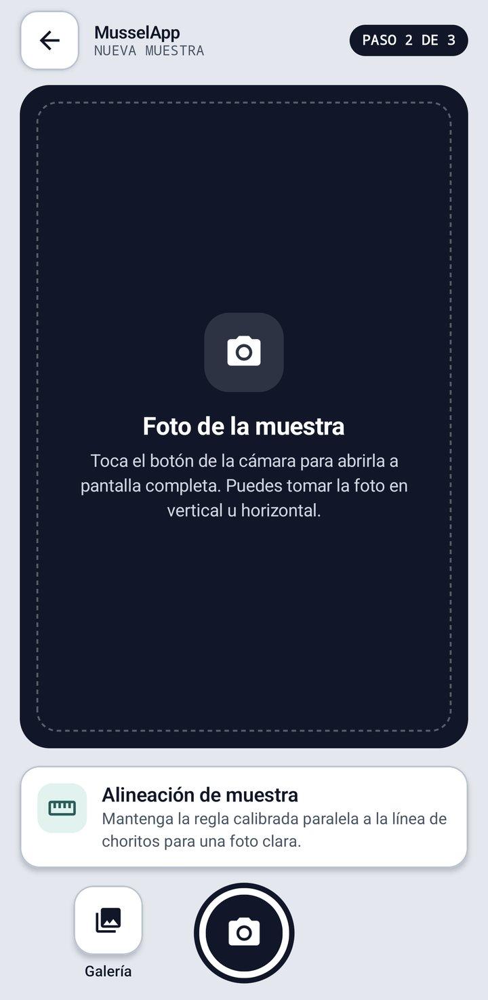 |

**Foto, Vista previa y conteo con marcas**

| Foto de la muestra | Vista previa | Conteo sobre la foto | Tramo y ubicación |
|---|---|---|---|
| 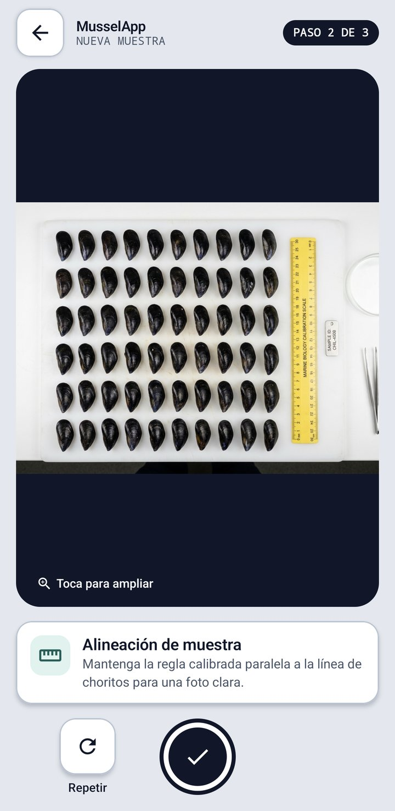 | 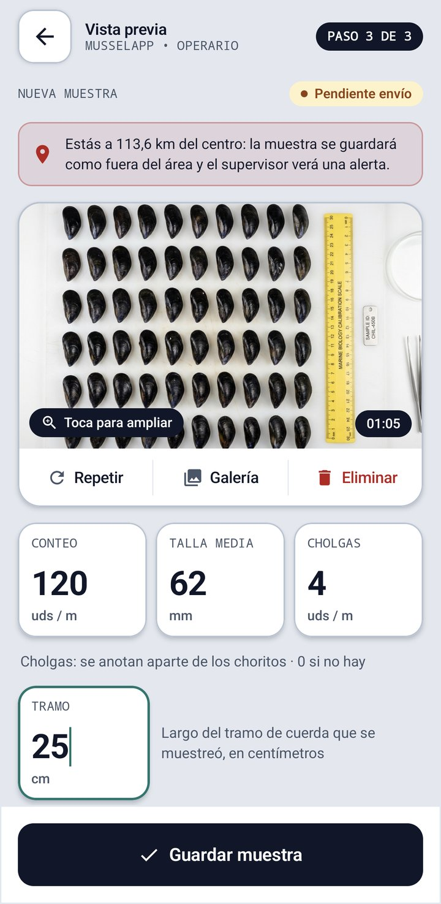 | 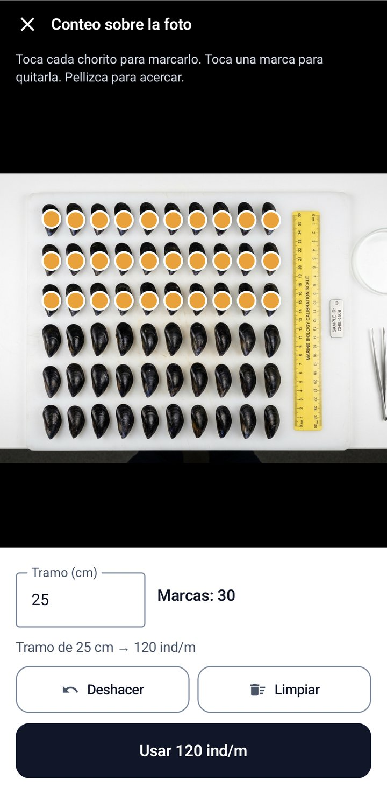 | 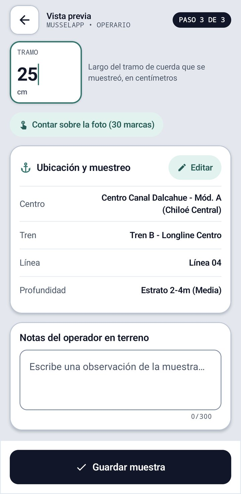 |

**Historial, Detalle y ficha PDF**

| Historial | Historial con detalle | Detalle | Condiciones al muestrear |
|---|---|---|---|
| 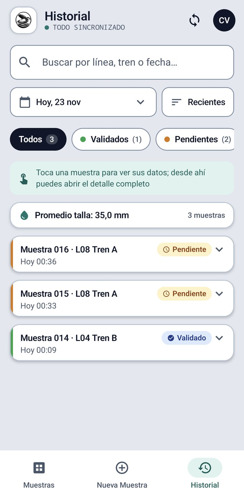 | 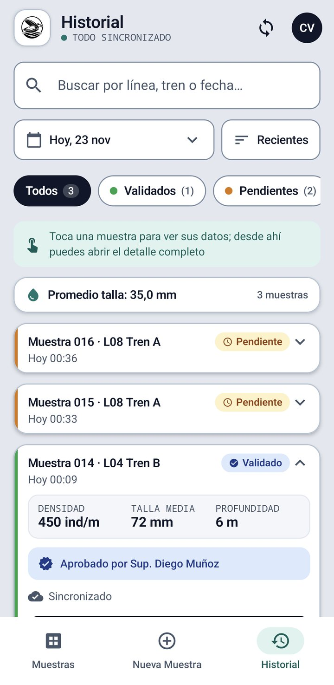 | 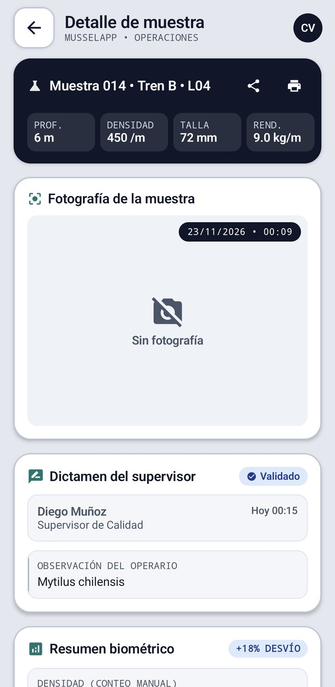 | 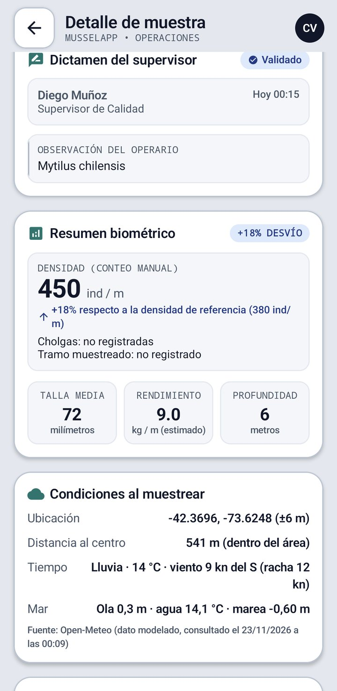 |

| Trazabilidad | Ficha técnica PDF |
|---|---|
| 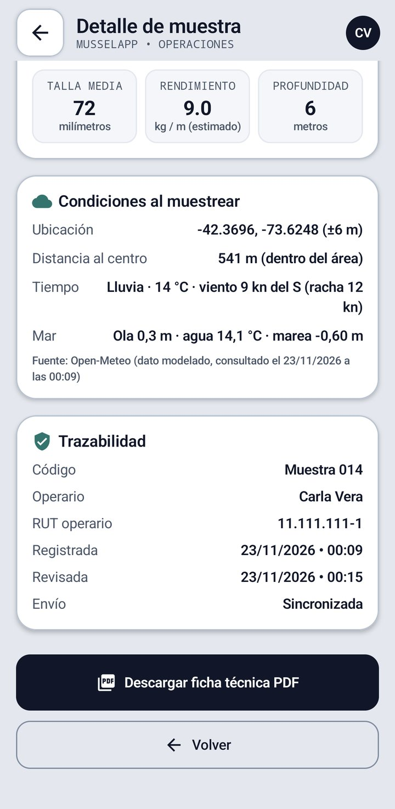 | 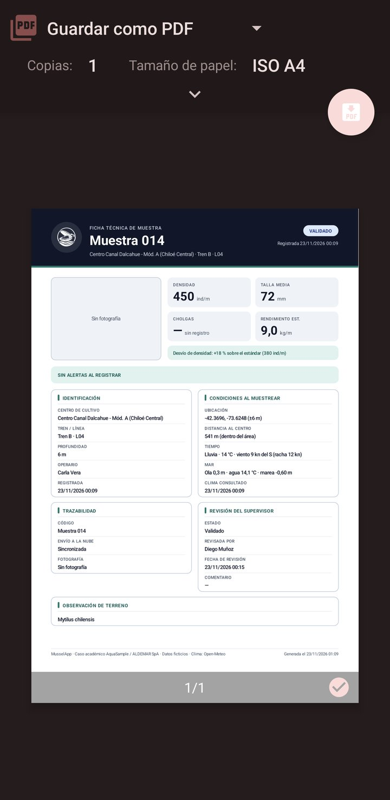 |

**Supervisor**

| Principal del supervisor | Revisión | Alertas y condiciones | Dictamen |
|---|---|---|---|
| 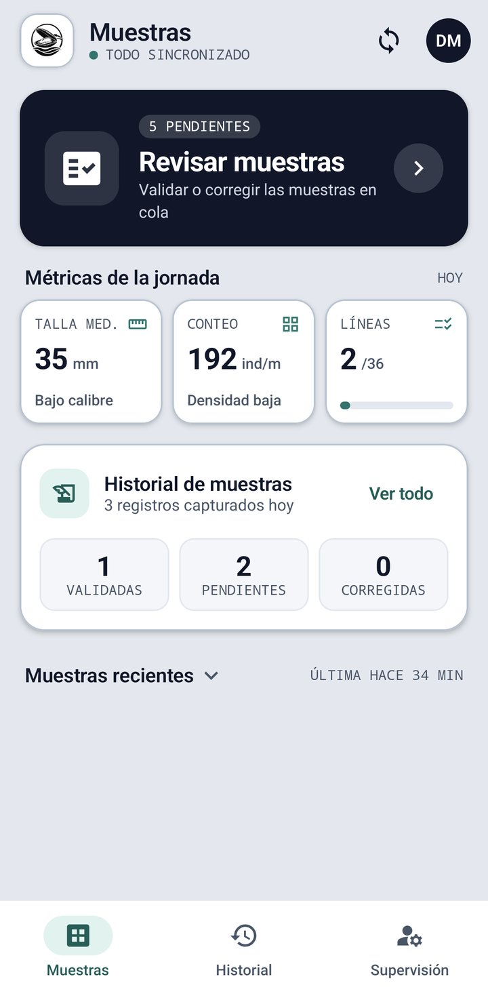 | 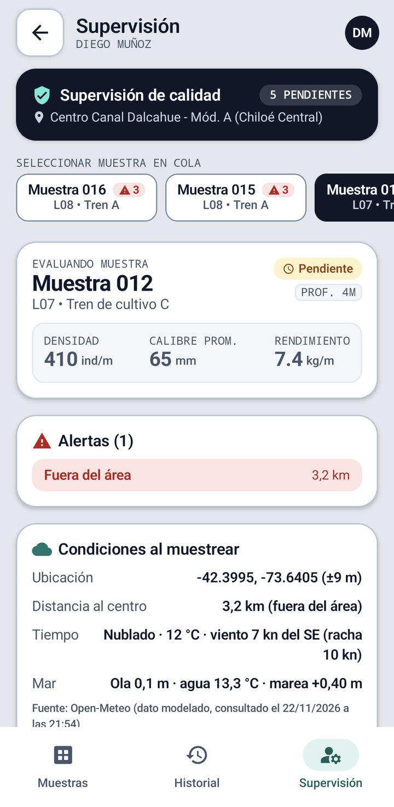 | 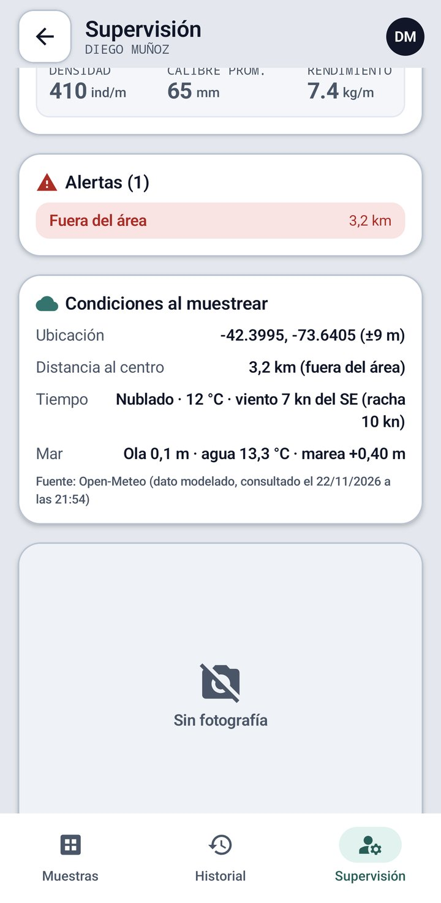 | 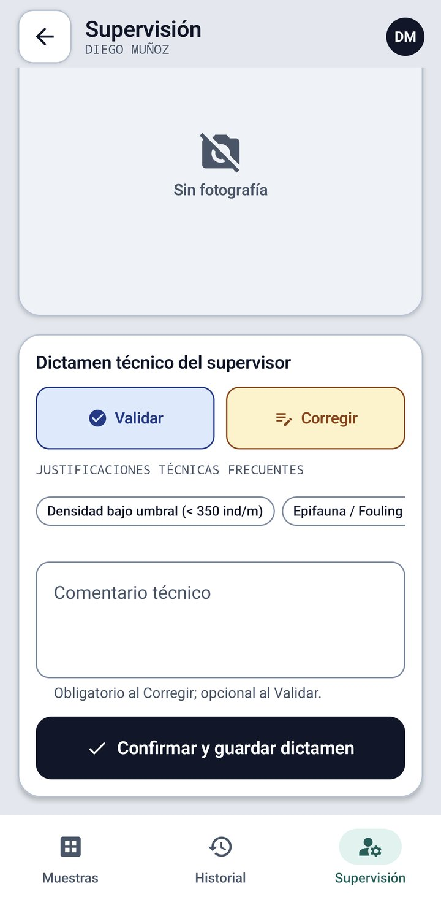 |

## 4. Instrucciones de ejecución

### Descargar APK

La última versión está en **Releases**: https://github.com/jesuscardenas-jacv1/MusselApp-Nube/releases/latest

1. Descargar `MusselApp-vX.Y.Z.apk` en el teléfono (Android 7.0 o superior).
2. Abrirlo y permitir la instalación de apps de origen desconocido.

Es el APK **debug** compilado en GitHub Actions. Si el teléfono ya tiene MusselApp instalada desde Android Studio o desde otra compilación, Android puede rechazar la instalación por tener otra firma: en ese caso hay que desinstalar primero, y eso **borra las muestras guardadas en el teléfono** (las que ya se subieron siguen en la nube).

### Requisitos

- **Android Studio** reciente (con soporte para AGP 9.3) y su JDK incluido.
- **Android SDK** con la plataforma **API 37** (`compileSdk`/`targetSdk` 37).
- Teléfono o emulador con **Android 7.0 (API 24)** o superior. Para probar la cámara se recomienda un teléfono físico.

### Pasos

1. Clonar el repositorio:
   ```bash
   git clone https://github.com/jesuscardenas-jacv1/MusselApp-Nube.git
   ```
2. Abrir la carpeta `MusselApp-Nube` en Android Studio y esperar la sincronización de Gradle.
3. Conectar un teléfono con la **depuración USB** activada (o iniciar un emulador).
4. Elegir la configuración **app** y presionar **Run ▶**.

También se puede compilar desde la terminal:

```bash
./gradlew assembleDebug        # genera app/build/outputs/apk/debug/app-debug.apk
./gradlew installDebug         # instala en el teléfono conectado
```

### Usuarios de prueba

La base se llena con datos ficticios la primera vez que se abre la app.

| Rol | RUT | PIN | Qué puede hacer |
|---|---|---|---|
| Operario (Carla Vera) | `11.111.111-1` | `1234` | Registrar muestras, ver historial y detalle |
| Supervisor (Diego Muñoz) | `22.222.222-2` | `1234` | Revisar, validar o corregir muestras |

Al abrir la app se muestra la animación de inicio. En el Login se ingresa RUT, PIN y el centro de cultivo de la jornada; el perfil (operario o supervisor) sale del usuario. Tras ingresar, una animación de bienvenida saluda por su nombre y da paso a la pantalla principal.

### Pruebas automatizadas

```bash
./gradlew testDebugUnitTest          # 180 pruebas unitarias (los 7 ViewModels, conteo con marcas, envío con WorkManager, validaciones, regla del comentario al corregir, catálogo de trenes y líneas, filtros, hash del PIN, alertas, distancia, clima, protección del dictamen)
./gradlew connectedDebugAndroidTest  # 45 pruebas instrumentadas: Room real, migraciones, catálogo, sincronización con una nube falsa y los Compose UI Test del formulario y del conteo (requiere teléfono o emulador)
./gradlew reporteCobertura           # cobertura de ViewModels y Repositories en app/build/reports/jacoco/reporteCobertura/html/index.html
```

> `connectedDebugAndroidTest` desinstala la app al terminar: no correrlo en un teléfono con muestras que se quieran conservar.

**Cobertura (JaCoCo, pruebas unitarias, 18-11-2026):** 72,5 % de las líneas de ViewModels y Repositories. Por clase:

| Clase | Líneas cubiertas |
|---|---|
| `LoginViewModel` | 100 % |
| `BorradorMuestraViewModel` (`BorradorMuestra.kt`) | 98,8 % |
| `RevisionViewModel` | 97,1 % |
| `MuestraViewModel` | 96,6 % |
| `HistorialViewModel` | 95,5 % |
| `PrincipalViewModel` | 94,4 % |
| `DetalleViewModel` | 93,3 % |
| `RoomMuestraRepository`, `RoomAuthRepository` | 0 % en unitarias: usan Room real y se prueban en las instrumentadas (`RepositoriosRoomTest`), que todavía no suman al reporte |

Los ViewModels, donde está la lógica de cada pantalla, superan el 90 %. Para llegar a más del 90 % en el total falta sumar la cobertura de las pruebas instrumentadas (`enableAndroidTestCoverage`).

Las mismas pruebas corren solas en **GitHub Actions** (`.github/workflows/android.yml`) en cada push a `main`, `feature/**`, `fix/**` o `mejoras/**` y en cada PR: compila, corre las unitarias y las instrumentadas en un emulador, y deja como artefactos descargables por 14 días el APK de debug y el reporte de cobertura (`reporte-cobertura`).

### Publicar una versión

El workflow `.github/workflows/release.yml` publica el APK como Release al subir un tag que empiece con `v`. Es independiente de `android.yml`:

```bash
git checkout main
git pull
git tag v1.1.0
git push origin v1.1.0
```

En unos minutos aparece el Release `v1.1.0` con `MusselApp-v1.1.0.apk` adjunto y notas generadas a partir de los PR. Antes de publicar corre las pruebas unitarias: si fallan, no se publica nada. Un tag con guion (`v1.1.0-rc.1`) se publica como pre-release.

- Antes de cada versión conviene subir `versionCode` (entero, siempre creciente) y `versionName` en `app/build.gradle.kts`, por ejemplo `2` / `"1.1.0"` para `v1.1.0`.
- **Plan B sin workflow:** en **Actions**, abrir el último run exitoso de *Android CI*, descargar el artefacto `MusselApp-debug-apk` y crear el Release a mano en **Releases → Draft a new release**.

### Firmar el APK release

`app/build.gradle.kts` firma el release con los datos de `keystore.properties`, en la raíz del proyecto. Ese archivo, la llave (`*.jks`) y sus contraseñas están en `.gitignore` y **nunca se suben**. Sin el archivo, el release se genera sin firmar.

1. Crear la llave una sola vez y guardarla fuera del repositorio (pide las contraseñas por consola):
   ```bash
   keytool -genkeypair -v -keystore ../musselapp-release.jks -alias musselapp -keyalg RSA -keysize 2048 -validity 10000
   ```
2. Copiar `keystore.properties.ejemplo` como `keystore.properties` y completar la ruta, el alias y las contraseñas.
3. Subir `versionCode` y `versionName` en `app/build.gradle.kts` (hoy `5` / `"1.3.1"`).
4. Generar el APK firmado:
   ```bash
   ./gradlew assembleRelease   # app/build/outputs/apk/release/app-release.apk
   ```

**Si se pierde la llave, no se puede publicar una actualización encima de la app instalada.** Hay que guardar una copia del `.jks` y de sus contraseñas en un lugar seguro del equipo. El APK release usa R8 y FLAG_SECURE (ver Seguridad).

### Portal web del supervisor

El supervisor revisa y dictamina las muestras desde el computador en **https://musselapp-demo.web.app** (Firebase Hosting). También se puede abrir [`web-supervisor/index.html`](web-supervisor/index.html) con doble clic en Chrome, sin servidor ni instalación. Se conecta al proyecto Firebase `musselapp-demo` y se actualiza en vivo. Entra con el mismo RUT y PIN de supervisor que en la app, o con **Ver con datos de ejemplo** para probar sin nube. Detalle de pantallas y funcionamiento en [`web-supervisor/README.md`](web-supervisor/README.md).

### Seguridad

Defensa en capas, según la guía de seguridad del equipo (18-11-2026):

| Capa | Medida | Dónde |
|---|---|---|
| Teléfono | PIN guardado con hash PBKDF2 (sal aleatoria, 10.000 iteraciones, comparación en tiempo constante) | `util/HashPin.kt` |
| Teléfono | Bloqueo tras 5 intentos fallidos (1, 2, 4, 8 y hasta 15 min), que no se salta cerrando la app | `BloqueoLogin.kt` |
| Teléfono | El mismo mensaje si el RUT no existe o si el PIN es incorrecto | `RoomAuthRepository.kt` |
| Teléfono | Sin respaldos de la base, las fotos ni las preferencias | `allowBackup="false"`, `data_extraction_rules.xml` |
| Teléfono | Solo se comparte la carpeta de las fichas PDF | `rutas_archivos.xml` (FileProvider) |
| Teléfono (release) | R8 reduce y ofusca el código y elimina los `Log.v/d/i` (ids de muestras e instalación) | `app/build.gradle.kts`, `keepRules/rules.keep` |
| Teléfono (release) | `FLAG_SECURE`: la app no aparece en apps recientes ni en capturas (el debug sí las permite) | `MainActivity.kt` |
| Nube | Sesión de Firebase obligatoria: el teléfono usa una sesión anónima y cada documento lleva su `ownerUid` | `NubeSync.kt` |
| Nube | Reglas por rol: sin sesión no se lee nada; el teléfono lee, crea y actualiza solo lo suyo, no puede cambiar un dictamen que ya está en la nube ni borrar; el supervisor del portal lee, dictamina y elimina todo | `firestore.rules`, probadas en `firestore-tests/` |
| Portal | Login real con Firebase Authentication usando el mismo RUT y PIN de la app; solo entran las cuentas con documento en `supervisores/{uid}` | `web-supervisor/index.html` |
| Portal | Escape de HTML (`esc()`) para que una observación no ejecute código en el navegador | `web-supervisor/index.html` |

**Límite conocido:** como el teléfono usa una sesión anónima, cualquiera que instale la app puede *crear* muestras a su nombre, pero no puede leer, cambiar ni borrar las de otros. Para la demo es aceptable.

**Pasos que se hacen en la consola de Firebase** (detalle en [`web-supervisor/README.md`](web-supervisor/README.md#cuentas-y-seguridad)):

- [ ] Authentication: activar **Anónimo** y **Correo electrónico/contraseña**
- [ ] Crear la cuenta del supervisor (correo `{rut}@musselapp.cl`, contraseña `pin-` + PIN) y su documento `supervisores/{uid}`
- [ ] Instalar la app nueva y abrirla una vez con internet
- [ ] Probar `firestore.rules` en la Zona de pruebas (sin sesión → denegado; teléfono que cambia un dictamen ya puesto o que borra → denegado)
- [ ] Publicar las reglas (la consola guarda el historial para volver atrás en un clic)

**APK release:** `./gradlew assembleRelease` genera `app/build/outputs/apk/release/app-release-unsigned.apk`. Para instalarlo hay que firmarlo (por ejemplo con `apksigner`). Después de instalarlo conviene probar el login, el registro con foto, el clima, la ficha PDF y la sincronización: si R8 rompe algo, el error en Logcat indica qué clase hay que mantener con `-keep`.

## 5. Arquitectura

La app sigue **MVVM**: la pantalla solo dibuja el estado, el ViewModel aplica las reglas y expone un `StateFlow<UiState>`, y el Repository es el único que habla con Room.

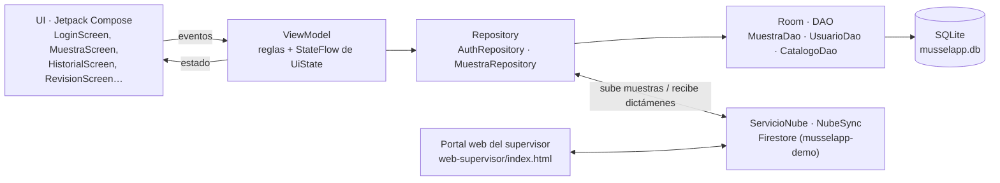

Room es la **fuente de verdad**: la app guarda primero en el teléfono y luego sube a Firestore. Si no hay red, la muestra queda pendiente de sincronizar y se reintenta.

```
app/src/main/java/cl/aldemar/musselapp/
├── AppContainer.kt          # crea la base y los repositorios (una sola vez)
├── data/
│   ├── local/               # Room: MusselDatabase, Migraciones, dao/, entidad/
│   ├── model/               # Muestra, Usuario, Rol, EstadoMuestra, CentroCultivo
│   ├── nube/                # ServicioNube, NubeSync (Firestore), ProteccionDictamen, avisos
│   ├── clima/ ubicacion/    # Open-Meteo (Retrofit) y GPS
│   └── repository/          # interfaces + implementaciones Room y de prueba
├── ui/
│   ├── login/ principal/ muestra/ screens/ historial/ detalle/ revision/
│   ├── navegacion/          # Rutas y MusselNavHost
│   ├── componentes/         # componentes reutilizables
│   └── theme/               # colores, tipografía y tema Material 3
└── util/                    # RutValidator, Fechas, FichaPdf, HashPin, AlmacenFotos…
```

El modelo de datos (diagrama entidad-relación y tablas) está documentado en [`docs/base-de-datos.md`](docs/base-de-datos.md).

## 6. Integrantes — Equipo Pipeño (Sección 004V)

| Nombre | GitHub | Rol |
|---|---|---|
| Jesús Cárdenas | [@jesuscardenas-jacv1](https://github.com/jesuscardenas-jacv1) | Front-end |
| Ramón Osorio | [@KanninoX](https://github.com/KanninoX) | UI/UX & Mobile Developer |
| Lucas Saldivia | [@lucsaldivia-ux](https://github.com/lucsaldivia-ux) | QA & Data Engineer |

## 7. Trabajo colaborativo

- **Ramas:** cada tarea se desarrolla en su propia rama (`feature/…` o `fix/…`); nunca directamente en `main`.
- **Pull Requests:** todo cambio entra a `main` por PR, con descripción, capturas y pasos para probar, revisado por otro integrante.
- **Commits** técnicos en español con prefijo (`feat:`, `fix:`, `test:`, `docs:`, `refactor:`).
- **Issues:** los hallazgos de la revisión técnica se registran como issues asignados.
- **Planificación:** pendientes y responsables en Trello — _enlace pendiente_.

## 8. Tecnologías

- **Kotlin** + **Jetpack Compose** con **Material 3**
- Arquitectura **MVVM** con **ViewModel** y **StateFlow**
- **Navigation Compose**
- Persistencia local con **Room 2.8** (SQLite, KSP)
- **Firebase Cloud Firestore** para sincronizar muestras y dictámenes
- **CameraX** y Activity Result API (permisos, Photo Picker)
- **Retrofit** + Gson para la API REST de clima (Open-Meteo)
- **Google Play Services Location** para la posición GPS
- **Gradle** (Kotlin DSL), Android Studio, **GitHub Actions** (CI)
- Portal web: HTML y JavaScript sin framework, Firebase (SDK compat), Chart.js, Leaflet con teselas de CARTO
- Diseño: **Google Stitch**, Mermaid para UML

### Equivalencias tecnológicas

Las pautas EA4 y EA5 nombran algunas librerías como recomendadas. Donde el proyecto cumple la misma función con otra herramienta, se usa esa:

| Pedido en la pauta | Lo que usa MusselApp | Por qué |
|---|---|---|
| Coil (cargar imágenes) | `BitmapFactory` con muestreo (`util/Fotos.kt`, `FotoMuestra.kt`) | Las fotos son archivos locales; se decodifican reducidas y no necesitan la caché de red de Coil |
| Telephoto (ampliar la foto) | `ui/componentes/VisorFoto.kt`: zoom de 1 a 5×, desplazamiento y doble toque | Misma función que el visor de Telephoto |
| MockK (dobles de prueba) | Dobles propios: `FakeMuestraRepository`, `FakeAuthRepository`, `FakeServicioNube`, `MuestrasEnMemoria` y funciones inyectables | Aíslan ViewModels y Repositories de Room, la red y los archivos, y permiten forzar errores |
| DataStore (preferencias) | `SharedPreferences` (`BloqueoLogin.kt`, instalación en `NubeSync.kt`) | Mismo almacenamiento clave-valor; los datos de negocio están en Room |
| Filtros por fechas y comparación por línea | App: búsqueda por tren y línea y períodos. Portal: filtros por tren, línea, estado, operario y fechas, y evolución por línea | El análisis se hace en el portal, junto al dashboard |
| Exportar validadas a PDF o .xlsx | Portal: XLSX, PDF, CSV y JSON con filtro por estado. App: ficha PDF por muestra | El informe se genera donde están los datos de todos los teléfonos |

### Decisiones del equipo

- **Dashboard con gráficos en el portal web, no en la app:** el supervisor analiza en el computador, con pantalla grande y los datos de todos los teléfonos; la app se enfoca en el trabajo en terreno.
- **Sin rol analista:** el supervisor cumple sus funciones (filtra el historial, revisa el dashboard y exporta), así que un tercer rol solo duplicaría permisos.
- **Sin estado "Observado":** los estados son Pendiente, Corregido y Validado. "Observar" es revisar la muestra antes de dictaminar, y Corregir incluye las observaciones al operario.
- **Backend propio (Spring Boot + Swagger):** implementado en [`backend/`](backend/README.md) con JPA + H2 persistente, permisos por rol (`X-Rol`), CRUD completo de muestras, fotos/metadatos, revisiones y reportes, y documentación OpenAPI en `/swagger-ui.html`. La app se conecta con **Retrofit** (`data/nube/BackendApi.kt` + `BackendSync.kt`) solo en la versión de depuración. Firestore sigue siendo la nube principal y el backend es **opcional**: si está apagado, ninguna muestra queda en cola. Cuando está disponible, el teléfono hace de puente entre ambos, y gana el primer dictamen. Detalle en [`backend/README.md`](backend/README.md).
- **Modificación en vivo:** el procedimiento completo (Spring Boot + Android) está en [`docs/ensayo-modificacion-en-vivo.md`](docs/ensayo-modificacion-en-vivo.md).

## 9. Identidad visual

| Elemento | Definición |
|---|---|
| Nombre | **MusselApp** |
| Logotipo | [`docs/diseno/logo.png`](docs/diseno/logo.png) · [`logo.svg`](docs/diseno/logo.svg) — representa el chorito chileno y la conexión con el mar del sur de Chile |

### Paleta de colores

| Color | HEX | Uso |
|---|---|---|
| Principal | `#0F172A` | Encabezados, TopAppBar y botones de acción clave (CTA) |
| Secundario | `#334155` | Encabezados de tablas, botones secundarios y navegación |
| Fondo | `#F1F5F9` | Fondo general; evita deslumbramiento bajo luz solar directa |
| Texto | `#000000` | Títulos, lecturas de datos y etiquetas de alto contraste |
| Adicional | `#475569` | Bordes de tarjetas, divisores, textos secundarios y metadatos (contraste AA) |

Paleta sobria y de alto contraste, pensada para una empresa de servicios y para uso en terreno.

## 10. Flujo de usuario (Diagrama de Actividad UML)

Imagen exportada: [`docs/diseno/flujo-usuario-uml.png`](docs/diseno/flujo-usuario-uml.png) · Fuente: [`flujo-usuario-uml.mmd`](docs/diseno/flujo-usuario-uml.mmd)

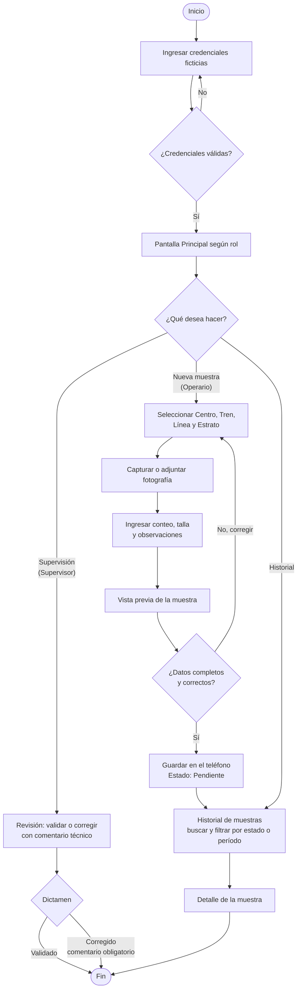

## 11. Diseño de interfaces

Diseños base generados con **Google Stitch** (Material Design 3), exportados en [`docs/diseno/stitch/`](docs/diseno/stitch/) (HTML y captura de cada pantalla, y el sistema de diseño). En [`docs/diseno/interfaces/`](docs/diseno/interfaces/) quedan solo las versiones ajustadas después de Stitch (login, principal, historial y detalle). Las capturas de la app real están en la sección 3.

| Pantalla | Objetivo | Diseño |
|---|---|---|
| Login | Verificación de credenciales de los usuarios | [`01-login.png`](docs/diseno/interfaces/01-login.png) |
| Principal | Menú de opciones según el rol | [`02-principal.png`](docs/diseno/interfaces/02-principal.png) |
| Muestra | Iniciar un muestreo | [`screen.png`](docs/diseno/stitch/3._formulario_nueva_muestra/screen.png) |
| Captura | Capturar un registro visual de la muestra | [`screen.png`](docs/diseno/stitch/4._captura_foto/screen.png) |
| Vista previa | Previsualizar fotografía y datos, y confirmar el muestreo | [`screen.png`](docs/diseno/stitch/5._vista_previa/screen.png) |
| Historial | Listar las muestras registradas | [`06-historial.png`](docs/diseno/interfaces/06-historial.png) |
| Detalle | Ver en detalle una muestra seleccionada | [`07-detalle.png`](docs/diseno/interfaces/07-detalle.png) |
| Revisión del Supervisor | Gestionar el estado de las muestras | [`screen.png`](docs/diseno/stitch/8._revisi_n_del_supervisor/screen.png) |

### Navegación

| Componente | ¿Se utiliza? | Para qué |
|---|---|---|
| NavigationBar | Sí | Operario: Muestras, Nueva Muestra e Historial · Supervisor: Muestras, Historial y Supervisión |
| NavigationDrawer | No | — |
| TopAppBar | Sí | Título de pantalla, volver, sincronizar y menú de perfil (cerrar sesión) |
| Botón principal | Sí | Tarjeta "Nueva muestra" (operario) o "Revisar muestras" (supervisor) en la Principal |

## 12. Estructura del repositorio

```
.github/workflows/           # CI (build + pruebas), reglas de Firestore y publicación del APK en Releases
app/                         # código fuente de la app Android
├── schemas/                 # esquemas exportados de Room (uno por versión)
└── src/
    ├── main/                # código, recursos y AndroidManifest.xml
    ├── test/                # pruebas unitarias
    └── androidTest/         # pruebas instrumentadas (Room)
backend/                     # backend propio Spring Boot + JPA (H2) + Swagger/OpenAPI
├── pom.xml                  # proyecto Maven (Spring Boot 3.5 + springdoc)
└── src/
    ├── main/                # entidades, repositorios, DTOs, servicios y controladores REST
    └── test/                # pruebas integradas con MockMvc
docs/
├── base-de-datos.md         # modelo de datos
├── capturas/                # capturas de la app real
├── diseno/
│   ├── logo.png · logo.svg
│   ├── flujo-usuario-uml.png · flujo-usuario-uml.mmd
│   ├── interfaces/          # pantallas diseñadas en Stitch
│   └── stitch/              # exportación original de Google Stitch
└── evidencias/
    └── clase-02/            # Evidencia_Clase_02_Diseno_EquipoPipeno
web-supervisor/              # portal web del supervisor (index.html + README)
```
