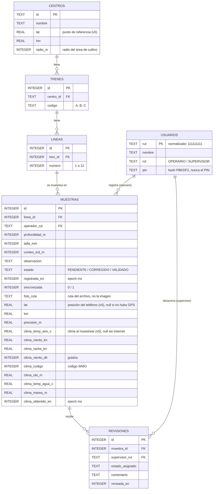

# Base de datos local — Room (SQLite)

MusselApp guarda sus datos en una base **SQLite** local usando **Room 2.8**.
Archivo: `musselapp.db`, en el almacenamiento privado de la app.
Esquema exportado: [`app/schemas/`](../app/schemas/) (se genera al compilar).

## Modelo entidad-relación



| Tabla | Modelo de la pauta | Descripción |
|---|---|---|
| `centros` | Centro | Centros de cultivo (datos ficticios) |
| `trenes` | Tren | Trenes de cultivo (longlines) de cada centro |
| `lineas` | Linea | Líneas de siembra de cada tren |
| `usuarios` | Usuario | Operarios y supervisores ficticios |
| `muestras` | Muestra, Conteo | Cada muestreo; el conteo de individuos es la columna `conteo_ind_m` |
| `revisiones` | EstadoRevision | Historial de dictámenes del supervisor (estado + comentario) |

## Decisiones de diseño

- **Fotos:** la imagen **no** se guarda en la base (una foto pesa varios MB y SQLite lee las filas en bloques de ~2 MB). Se guarda como archivo privado de la app y la tabla solo guarda `foto_ruta`.
  - Carpeta: `filesDir/fotos/` (privada: otras apps no la ven). Las fotos aún sin confirmar quedan en `cacheDir/pendientes/`.
  - Todo el manejo de archivos está en `util/AlmacenFotos.kt`; `AlmacenFotos.borrar()` solo borra archivos de la app, nunca la copia de la galería.
  - Las fotos de la cámara además se copian a la galería del teléfono (`Pictures/MusselApp`), como antes.
  - Al repetir o eliminar una foto, o al cerrar sesión con una muestra a medio registrar, el archivo anterior se borra (`BorradorMuestraViewModel`), así no quedan fotos sin muestra.
- **Historial de revisiones:** cada dictamen es una fila nueva en `revisiones`, para mantener la trazabilidad. El estado vigente queda también en `muestras.estado`, y ambos se actualizan en una sola transacción (`MuestraDao.registrarRevision`).
- **Posición y clima (v5):** todas las columnas aceptan null. La posición se lee al confirmar la muestra; el clima se pide a Open-Meteo después de insertarla (`MuestraDao.guardarClima`), para que guardar nunca espere a la red. Si no hay internet, se reintenta al sincronizar mientras la muestra tenga menos de 2 horas. La distancia al centro y las alertas **no** se guardan: se calculan (`util/Distancia.kt`, `util/AlertasMuestra.kt`).
- **Área del centro:** `centros` guarda un punto de referencia y un radio (1.500 m). Una muestra tomada más lejos genera la alerta "Fuera del área" para el supervisor. Las coordenadas son ficticias y coinciden con las del mapa del portal.
- **Integridad:** claves foráneas entre todas las tablas. No se puede registrar una muestra en una línea o con un operario que no existe.
- **Datos iniciales:** al crear la base por primera vez se cargan centros, trenes A–C, líneas 1–12, los 2 usuarios de prueba y 14 muestras ficticias (`DatosIniciales.kt`).
- **PIN como hash:** la columna `pin` guarda `pbkdf2$iteraciones$sal$hash` (PBKDF2 con HmacSHA1, disponible desde minSdk 24), calculado en `util/HashPin.kt`. El login compara contra el hash, nunca contra el PIN.
- **Sin respaldo en la nube:** `allowBackup="false"` y las reglas de `res/xml/` excluyen la base, las fotos y las preferencias del respaldo y de la transferencia entre teléfonos.
- **Migraciones:** `data/local/Migraciones.kt`. La v2 convierte el estado Observado (eliminado) en Corregido sin perder muestras; la v3 reemplaza cada PIN en texto plano por su hash; la v4 agrega el conteo de cholgas y la v5 la posición, el clima y las coordenadas de los centros (todas en `MigracionesTest`). Si faltara una migración, `fallbackToDestructiveMigration` recrea la base.
- **Un solo dispositivo:** Room es local; operario y supervisor deben usar el mismo teléfono en la demo. La columna `sincronizada` y la interfaz `MuestraRepository` dejan listo el camino para sincronizar con un servidor en una etapa futura.

## Estructura del código

```
data/local/
├── MusselDatabase.kt     # @Database, versión y creación
├── DatosIniciales.kt     # datos ficticios iniciales
├── Mapeos.kt             # filas de Room → modelos de las pantallas
├── entidad/              # @Entity: Centro, Tren, Linea, Usuario, Muestra, Revision
└── dao/                  # @Dao: CatalogoDao, UsuarioDao, MuestraDao
AppContainer.kt           # crea la base una sola vez para toda la app
MusselApplication.kt      # registra el contenedor (android:name en el Manifest)
```

## Plan de integración

| Fase | Qué | Responsable | Estado |
|---|---|---|---|
| 1 | Room, entidades, DAO, base, datos iniciales y pruebas | Ramón | ✅ esta rama |
| 2a | `RoomMuestraRepository`: listar, obtener, agregar, sincronizar; conectar Principal e Historial | Ramón | ✅ PR #15 |
| 2b | `actualizarEstado` con `registrarRevision`; conectar Detalle y Revisión | Lucas | ✅ PR #15 |
| 2c | Guardar la muestra desde el ViewModel (antes se hacía en el `NavHost`), sin conteo ni talla inventados, y la foto en `filesDir/fotos/` | Jesús | ✅ PR #18 + `feature/fotos-carpeta-privada` |
| 3 | `RoomAuthRepository`: login contra la tabla `usuarios` | Ramón | ✅ PR #15 |
| 4 | Prueba completa: registrar, cerrar la app, reabrir y ver la muestra; README | Todos | Pendiente |

Para ver la base en Android Studio: **App Inspection → Database Inspector** con la app corriendo.

## Pruebas

`app/src/androidTest/.../MusselDatabaseTest.kt` (base en memoria, corre en un dispositivo):
datos iniciales, consulta con joins y última revisión, registro de revisiones con historial,
inserción de muestra nueva y rechazo por clave foránea.
